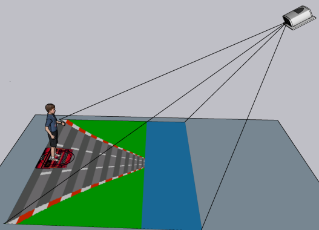

<h1>T-TEA</h1>

<div>
  

  <h3>Interactive Floor Console for Exergames</h3>

  <p align="justify">
    Software for an Interactive Floor console developed initially with a focus on people with Autism Spectrum Disorder (ASD), but which also allows the creation of serious games for other audiences. The project was developed by PhD candidate André Bonetto Trindade and Gabriel Brunelli Pereira, under the supervision of Prof. Marcelo da Silva Hounsell (UDESC). The T-TEA project (Torre para crianças com Transtorno do Espectro Autista / Tower for children with Autism Spectrum Disorder) aims to assist sensory processing therapy through an interactive, mobile, and low-cost platform.
  </p>

  <p align="justify">
    The hardware consists of a conventional video projector, webcam, and computer. The webcam is a relatively inexpensive device and can be easily found, which can be seen as a positive factor for the adoption of the game in public institutions.
  </p>

  <p align="justify">
    Since the projector and computer are conventional equipment, institutions can use devices they already have available. In this way, by reusing equipment, the final cost of the T-TEA platform is significantly reduced.
  </p>

  <p align="justify">
    This equipment is installed on a physical structure that is simple to assemble and easy to transport.
  </p>
</div>

<br clear="all">

<h2>Games</h2>

<p align="justify">
  T-TEA features different serious games developed with therapeutic goals and aimed at stimulating different skills.
</p>

<div>
  

  <h3>Kartea</h3>

  <p align="justify">
    Its goal is to help develop multisensory integration by stimulating the player's concentration, attention, motor coordination, and laterality. Its mechanics place the player on a 3-lane road, putting them in control of a car through the lateral movement of their body.
  </p>

  <p align="justify">
    The player must move only laterally across the screen, capturing targets (stars) and avoiding obstacles (barriers) to score points and advance levels.
  </p>

</div>

<br clear="all">

## Development

### Requirements

- Python >= 3.10
- [uv](https://docs.astral.sh/uv/) >= 0.11.32
- Windows x86-64, macOS Apple Silicon, or Linux x86-64. Linux ARM64 is deferred.

### Installing uv

uv automatically downloads and manages the correct Python version and the project's dependencies.

macOS:

```bash
brew install uv
```

Windows (PowerShell):

```powershell
winget install --id=astral-sh.uv -e
```

Linux:

```bash
curl -LsSf https://astral.sh/uv/install.sh | sh
```

### Running

From the project root, on any system:

```bash
uv run dev
```

This command downloads the correct Python version, creates the `.venv`, syncs dependencies, and starts T-TEA.

### Running without uv (manual venv)

With Python 3.10, 3.11 or 3.12 installed, from the project root:

macOS / Linux:

```bash
python3 -m venv .venv
.venv/bin/python -m pip install -e .
.venv/bin/dev
```

Windows (PowerShell):

```powershell
py -3.12 -m venv .venv
.venv\Scripts\python -m pip install -e .
.venv\Scripts\dev
```

pip installs the versions pinned in `pyproject.toml`. Indirect dependencies aren't pinned the way `uv.lock` pins them, so prefer uv whenever possible.

### Important

On first use, allow camera access in your system's privacy settings.

### TSDK game development

`uv run dev` opens the console only. TSDK game developer mode lives in the local `../tsdk`
repository: from a game checkout containing `ttea.toml`, run `uv run tsdk dev`, alongside
`uv run tsdk check` and `uv run tsdk build`.

See [the TSDK implementation contract](docs/sdk-platform-plan.md#local-implementation-and-operation)
for runtime callbacks, recording/replay, cartridge installation, and release gates.
Existing checkout-local data needs explicit migration to the platform user-data
directory before first launch; the linked guide provides a non-overwriting command.

### Install, update, and recover TSDK games

KarTEA is an independent cartridge developed in `../kartea`, not bundled with TTEA.
The catalog has no published releases yet. Public installation is not available at this stage.

| Operation | Procedure |
| --- | --- |
| Install | Select a game with a compatible release and choose **Instalar**. Use reviewed publishers only. |
| Update | End the session, choose **Atualizar**, and confirm the offered version. |
| Failed update | Keep existing data and the previous installation. Record the error; do not edit receipts or SHA-256 digests. |
| Offline play | Launch an installed cartridge. No new download is required. |
| Uninstall | End the session and choose **Desinstalar**. Results remain in the data directory. |

Back up the data directory before migrating an older installation.
Use the [non-overwriting migration procedure](docs/sdk-platform-plan.md#existing-data-needs-explicit-migration); do not merge participant records automatically.
Older calibrations do not record how they were captured; recalibrate (manual or ChArUco) before the first game.
P pauses/resumes; Escape ends the session. Tracking loss pauses play until recovery.
Simulation does not establish physical calibration, safety, or clinical accuracy.
A checksum proves integrity, not licensing or publisher trust.
Check the [release gates](docs/sdk-platform-gap-report.md) before distributing cartridges.

<br clear="all">

<h1 align="center">Credits</h1>
<p align="center">
  <a href="https://github.com/larvattea"></a><a href="https://github.com/larvattea"></a><a href="https://github.com/larvattea"></a>
</p>