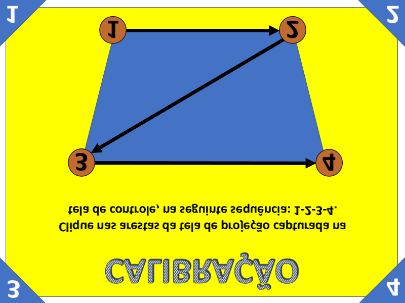

.. index::
   single: calibração

Calibração
==========

Por que e quando calibrar a câmera com a área projetada no chão. A calibração deve ser feita a cada nova montagem do console.

   Mapa de calibração projetado no chão.

.. toctree::
   :maxdepth: 1

   calibracao_manual
   calibracao_automatica

.. note::

   Página em construção.
